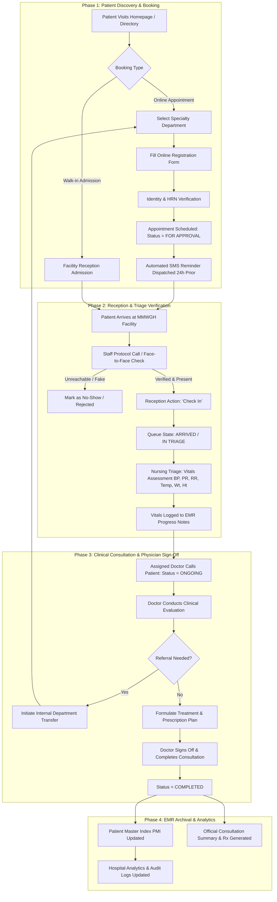
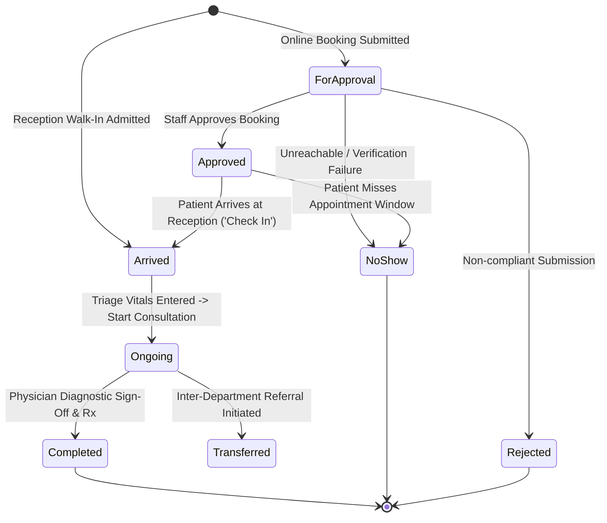

# MMWGH LINKod — Service Delivery Network (SDN)
### Localized Network and Knowledge-base for Online Service Delivery

[](https://php.net/)
[](https://svelte.dev/)
[](https://vitejs.dev/)
[](https://www.mysql.com/)
[](https://mmwgh.gov.ph/)

---

## 📌 Executive Overview

**MMWGH LINKod** is an enterprise clinical appointment scheduling, triage management, electronic medical record (EMR) tracking, and inter-department referral system developed for the **Mariveles Mental Wellness and General Hospital (MMWGH)**. 

The platform bridges public patient access, clinical nursing triage, attending physician consultations, and administrative health analytics across hospital departments:
- **General Management & Primary Care**
- **Neurology Specialization**
- **Outpatient Psychiatry Unit (OPU)**

---

## 🔄 End-to-End Clinical System Workflow

The following flowchart outlines the lifecycle of a patient visit from initial discovery through registration, clinical triage, consultation, and medical record archiving:



---

## 👥 User Roles & Access Control (RBAC)

| Role | Portal Endpoint | Core Responsibilities |
| :--- | :--- | :--- |
| **Patient / Client** | `/sdn/index.php`<br>`/sdn/pages/department-select.php`<br>`/sdn/pages/schedules.php` | - Explore doctor availability, specialties, and open slots in real time.<br>- Book online consultations with privacy consent verification.<br>- Search hospital master index by HRN/Patient ID for returning care.<br>- Access interactive campus map with turn-by-turn facility navigation.<br>- Chat with AI Chibi Medical Assistants (**Dr. Leo** & **Nurse Mika**) in EN/TL. |
| **Medical Staff** | `/sdn/pages/staff-dashboard.php` | - Manage active department queue (Online Bookers, Walk-ins, No-Shows).<br>- Perform identity verification and reception **Check In**.<br>- Enter and record clinical triage vital signs into patient EMR.<br>- Conduct consultations, document progress notes, and execute doctor sign-off.<br>- Dispatch manual SMS reminders or manage double-booking conflict protocols.<br>- Update real-time doctor clinic duty statuses (*In Clinic*, *On Break*, *Emergency*, *Off Duty*). |
| **Administrator** | `/sdn/pages/admin-dashboard.php` | - Cross-department monitoring of hospital-wide queues and patient throughput.<br>- User management (role assignment, department assignment, credentials).<br>- Doctor management (roster, slot limits, specialized consultation schedules).<br>- Patient Master Index (PMI) administration and clinical history export.<br>- Real-time KPI charts and statistical analytics export (CSV/PDF).<br>- Security audit log review tracking clinical events and user actions. |

---

## 🏥 Clinical Workflow Stages & Actions



### Detailed Stage Specifications

1. **For Approval (`for_approval`)**:
   - The appointment request is registered in the database.
   - Staff protocol triggers contact verification to ensure patient authenticity and reduce appointment slot hoarding.

2. **Approved (`approved`)**:
   - Patient contact is verified and designated an appointment window.
   - System queues automated 24-hour and morning SMS reminder dispatches (`cron/send_reminders.php`).

3. **Check In / In Triage (`arrived`)**:
   - Patient arrives at the reception area.
   - Staff clicks the imperative **Check In** button.
   - Nursing staff conducts primary triage, logging Blood Pressure (BP), Pulse Rate (PR), Respiratory Rate (RR), Temperature (°C), Weight (kg), and Height (cm).

4. **Ongoing Consultation (`ongoing`)**:
   - Patient is admitted to the attending physician's examination room.
   - Attending doctor reviews chief complaints, past medical histories (PMH), and current vitals.

5. **Completed & Doctor Sign-Off (`completed`)**:
   - Physician enters final clinical diagnosis, treatment protocol, prescription details, and follow-up appointment date.
   - Physician executes electronic sign-off, automatically generating printable consultation summaries and locking the clinical encounter.

6. **Inter-Department Transfer (`transferred`)**:
   - If a patient requires secondary assessment (e.g. general triage identifies psychiatric or neurological indicators), staff initiates an internal transfer with retained medical notes.

---

## 🏗️ Project Architecture

```
sdn/
├── api/                             # RESTful Backend API Endpoints (PHP)
│   ├── config/                      # Database PDO and CORS configurations
│   ├── admin-stats.php              # Administrator KPI dashboard metrics
│   ├── auth.php                     # Authentication, role gating & session login
│   ├── doctors.php                  # Doctor directory & duty status management
│   ├── history.php                  # Patient clinical history & progress notes
│   ├── logs.php                     # Immutable security audit log stream
│   ├── patients.php                 # Queue queries, status transitions & verification
│   ├── public-stats.php             # Public landing page real-time statistics
│   ├── registration.php             # Multi-department patient appointment intake
│   ├── reports.php                  # Demographic & clinical analytics export
│   └── schedule.php                 # Real-time department doctor schedule feed
│
├── cron/                            # Automated Background Tasks
│   └── send_reminders.php           # Scheduled SMS dispatch for upcoming appointments
│
├── pages/                           # Server-Rendered Portal Views (PHP)
│   ├── admin-dashboard.php          # System administrator dashboard & RBAC
│   ├── staff-dashboard.php          # Clinical queue, triage & doctor duty portal
│   ├── department-select.php        # Specialty department selection & booking portal
│   ├── schedules.php                # Public specialist directory & slot calendar
│   ├── login.php                    # Multi-role authentication gateway
│   ├── logout.php                   # Secure session termination
│   ├── regis-general.php            # General Medicine registration intake
│   ├── regis-neurology.php          # Neurology registration intake
│   ├── regis-psychiatry.php         # Outpatient Psychiatry (OPU) registration intake
│   └── location-map.php             # Interactive campus & facility wayfinding
│
├── public/                          # Static Assets & Styling
│   ├── assets/                      # Hospital brand graphics, media & chibi sprites
│   ├── css/
│   │   ├── global.css               # Global CSS variables, reset & typography
│   │   ├── admin-portal.css         # Admin dashboard design system
│   │   └── staff-portal.css         # Staff dashboard design system & indicators
│   └── js/
│       ├── admin-portal.js          # Admin SPA dynamic modules & table handlers
│       └── staff-portal.js          # Staff clinical queue & modal controllers
│
├── src/                             # Pure Front-End Svelte Architecture
│   ├── components/
│   │   ├── layout/                  # Framing elements (Container, Footer, TopNav)
│   │   ├── landing/                 # Hero, StatsBox, Services, About, Location
│   │   ├── auth/                    # VideoBackground, BrandShowcase, RoleSelector
│   │   ├── schedules/               # DoctorCard, DepartmentTabs, ScheduleFilters
│   │   ├── chatbot/                 # Chatbot, ChatSpeechBubble, QuickReplies, Rating
│   │   └── ui/                      # Reusable UI (Button, Badge, Modal, Input, etc.)
│   ├── services/                    # API services (api, auth, schedule, stats, chatbot)
│   ├── stores/                      # Reactive state stores (auth, schedule, chatbot, toast)
│   ├── types/                       # Enums & metadata (departments, roles, statuses)
│   ├── utils/                       # Helpers (formatters, validators, storage)
│   ├── App.svelte                   # Landing application root
│   ├── LoginApp.svelte              # Portal login application root
│   ├── SchedulesApp.svelte          # Schedule directory root
│   └── main.js                      # Svelte mounting orchestrator
│
├── dist/                            # Production Compiled Frontend Bundles (Vite)
├── scheduling_db.sql                # Complete MySQL relational database schema
└── vite.config.js                   # Vite bundling & proxy configuration
```

---

## 🛠️ Installation & Local Setup

### 1. Prerequisites
- **Web Server**: Apache (XAMPP / WAMP / Native)
- **PHP**: Version 8.1 or higher (with `pdo_mysql` enabled)
- **Database**: MySQL 8.0+ or MariaDB 10.4+
- **Node.js**: Node 18+ & npm (for compiling Svelte frontend assets)

### 2. Database Configuration
1. Start MySQL via XAMPP Control Panel.
2. Open phpMyAdmin or your MySQL client and create a new database:
   ```sql
   CREATE DATABASE scheduling_db CHARACTER SET utf8mb4 COLLATE utf8mb4_unicode_ci;
   ```
3. Import the database schema from the repository root:
   ```bash
   mysql -u root -p scheduling_db < scheduling_db.sql
   ```
4. Verify database credentials in [api/config/db.php](file:///c:/xampp1/htdocs/sdn/api/config/db.php):
   ```php
   $host = '127.0.0.1';
   $db   = 'scheduling_db';
   $user = 'root';
   $pass = ''; // Set your local MySQL password
   ```

### 3. Frontend Build (Optional during Development)
To re-compile the modern Svelte components into the production bundle:
```bash
# Install frontend dependencies
npm install

# Build production assets
npm run build
```
Compiled assets will output directly to `/dist/assets/main.js` and `/dist/assets/main.css`.

### 4. Running Automated Reminders
To test or execute the automated appointment reminder dispatch cron:
```powershell
php cron/send_reminders.php
```

---

## 🔐 Default Access Accounts

> [!IMPORTANT]
> The default credentials below are for initial staging and local verification. Passwords should be updated immediately in production environments via Account Settings.

| Role | Username | Default Password | Portal Access |
| :--- | :--- | :--- | :--- |
| **System Admin** | `admin` | `admin123` | `/sdn/pages/login.php` (Administrator Portal) |
| **General Staff** | `staff.general` | `staff123` | `/sdn/pages/login.php` (Medical Staff Portal) |
| **Neurology Staff**| `staff.neuro` | `staff123` | `/sdn/pages/login.php` (Medical Staff Portal) |
| **Psychiatry Staff**| `staff.psych` | `staff123` | `/sdn/pages/login.php` (Medical Staff Portal) |

---

## 📄 Compliance & Data Privacy
MMWGH LINKod adheres to the provisions of the **Philippine Republic Act No. 10173 (Data Privacy Act of 2012)**. All patient identity data, clinical diagnoses, and consultation notes are safeguarded through prepared PDO statements, role-gated backend middleware, and audit logs.